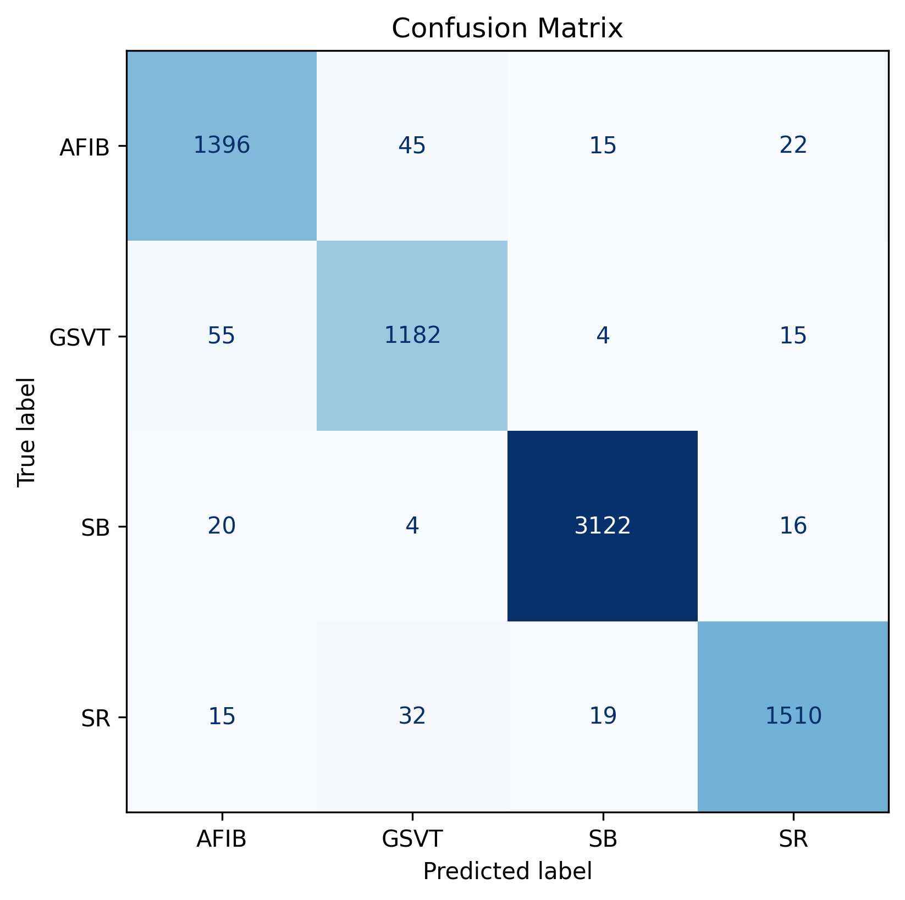
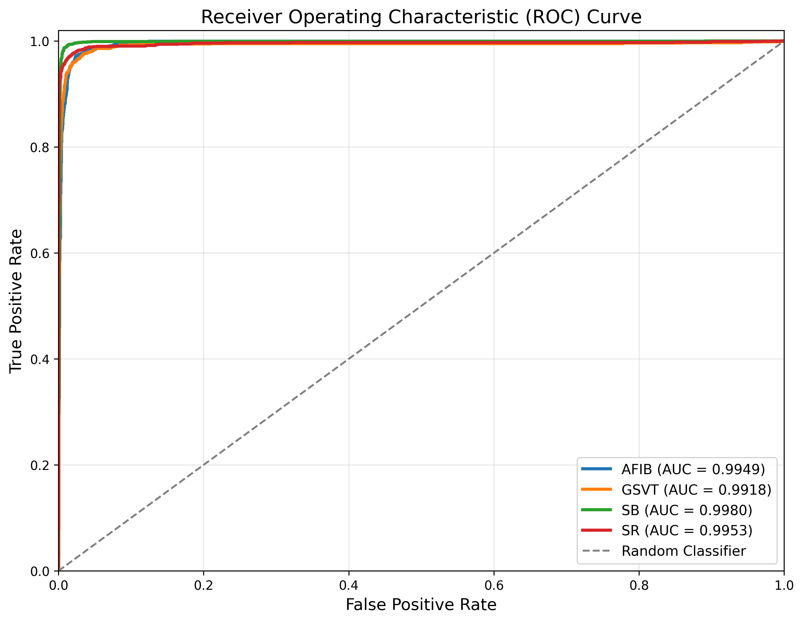

# CardioFormerNet: Hybrid CNN–CBAM–Transformer for Multi-Class ECG Arrhythmia Classification

**Research Internship Project — National Institute of Technology Warangal**

A deep learning pipeline that classifies 12-lead ECG recordings into four rhythm classes by converting each lead into a Short-Time Fourier Transform (STFT) spectrogram and passing the 12-channel spectrogram stack through a Residual CNN, a Convolutional Block Attention Module (CBAM), and a Transformer Encoder.

```
ECG Signal → Preprocessing → STFT → Spectrogram → Residual CNN → CBAM → Transformer Encoder → Classification → Evaluation → Explainability (Grad-CAM)
```

---

## Objective

Build and evaluate an automated ECG arrhythmia classifier on the Chapman–Shaoxing 12-lead ECG database that:

- represents each recording as a time–frequency image (STFT spectrograms for all 12 leads),
- combines local feature extraction (Residual CNN), feature refinement (CBAM attention), and global context modelling (Transformer Encoder),
- reports standard classification metrics, ROC/PR analysis, error analysis, and Grad-CAM visual explanations.

---

## Dataset

**A large scale 12-lead electrocardiogram database for arrhythmia study (v1.0.0)** — Chapman University & Shaoxing People's Hospital, distributed by PhysioNet.

| Property | Value |
|---|---|
| Records indexed | 45,152 |
| Leads | 12 |
| Sampling frequency | 500 Hz |
| Duration per record | 10 s (5,000 samples) |
| Format | WFDB (`.hea` header + `.mat` signal) |
| Labels | SNOMED-CT diagnosis codes in each header |
| Source | https://physionet.org/content/ecg-arrhythmia/1.0.0/ |
| License | Creative Commons Attribution 4.0 International (CC BY 4.0) |

The raw signal files are **not** included in this repository. Download them from PhysioNet (see [Reproducing the project](#reproducing-the-project)). The notebook was run on Kaggle against a Kaggle-hosted copy of the same dataset.

### Label construction

1. **Header parsing** – each `.hea` file is parsed for lead count, sampling rate, signal length, age, sex, and `Dx` SNOMED-CT codes → `csv files/metadata.csv`.
2. **SNOMED-CT mapping** – codes are mapped to acronyms and names with the dataset's `ConditionNames_SNOMED-CT.csv` (4 duplicated codes resolved by keeping the first entry; 55 unique codes). 51 of the 94 codes present in the data were mappable.
3. **Primary label** – the first mapped diagnosis of each record. 2,267 records with an unmapped primary label were removed (45,152 → 42,885).
4. **Class consolidation** – primary labels were grouped into four rhythm classes; all other labels were excluded:

| Final class | Source labels | Records |
|---|---|---|
| **SB** – Sinus Bradycardia | SB | 15,807 |
| **SR** – Sinus Rhythm | SR, SI | 7,882 |
| **AFIB** – Atrial Fibrillation / Flutter | AF, AFIB | 7,388 |
| **GSVT** – General Supraventricular Tachycardia | SVT, AT, ST, AVRT, AVNRT, SAAWR, WAP | 6,279 |
| **Total** | | **37,356** |

The resulting labelled metadata is saved as `processed_dataset/filtered_metadata.csv`.

---

## Preprocessing

Spectrograms are generated on-the-fly inside a `tf.data` pipeline (no spectrogram images are stored on disk).

For each of the 12 leads:

1. Replace NaN/±Inf with 0.
2. Z-score normalise the lead (leads with σ < 1e-8 become an all-zero image).
3. STFT with `scipy.signal.stft` — Hann window, `nperseg=512`, `noverlap=256`, fs = 500 Hz.
4. Magnitude → `log1p`.
5. Resize to **224 × 224** (bilinear, `scipy.ndimage.zoom`).
6. Min–max scale to [0, 1].

The 12 lead spectrograms are stacked into a **224 × 224 × 12** tensor.

**Augmentation (training only):** random contrast (0.95–1.05) in the data pipeline, plus `RandomTranslation(0.01, 0.01)` and `RandomZoom(0.03)` layers.

**Split:** stratified 80 / 20 train/test split (`random_state=42`) → 29,884 training and 7,472 test records.

---

## Model Architecture

Model name: `ECG_CNN_CBAM_Transformer` — **5,126,215 parameters** (5,121,735 trainable).

| Stage | Details |
|---|---|
| Input | 224 × 224 × 12 STFT spectrogram stack |
| Stem | Conv2D 64, 7×7, stride 2 → BatchNorm → ReLU → MaxPool 3×3, stride 2 |
| Residual CNN | 3 stages × 2 residual blocks: 64 → 128 (stride 2) → 256 (stride 2) filters; each block = 2 × (Conv 3×3 + BN), ReLU, 1×1 projection shortcut when shape changes; L2 = 5e-4 |
| CBAM | Channel attention (shared MLP, reduction ratio 8, GELU; avg + max pooling; sigmoid) followed by spatial attention (channel-wise mean & max → 7×7 Conv, sigmoid) |
| Tokenisation | Feature map reshaped to a token sequence → Dense projection to 256-d |
| Positional embedding | Learnable positional embedding |
| Transformer Encoder | 4 pre-norm blocks: LayerNorm → Multi-Head Attention (8 heads, key dim 32, dropout 0.2) → residual; LayerNorm → Dense 512 (GELU) → Dropout 0.2 → Dense 256 → Dropout 0.2 → residual |
| Head | LayerNorm → GlobalAveragePooling1D → Dropout 0.4 → Dense 256 (ReLU, L2 5e-4) → Dropout 0.3 → Dense 4 (Softmax) |

See `Images/architecture_overview.png` and `Images/cnn_transformer_architecture.png` (Keras `plot_model` output).

---

## Training

| Setting | Value |
|---|---|
| Framework | TensorFlow 2.20.0 / Keras |
| Hardware | Kaggle, 2 × NVIDIA Tesla T4 |
| Epochs | 25 (all 25 completed) |
| Batch size | 32 (934 steps/epoch) |
| Optimizer | AdamW (weight decay 5e-4, β₁ 0.9, β₂ 0.999, ε 1e-7) |
| Learning rate | Cosine decay from 3e-4 (α = 0.01) over 25 epochs |
| Loss | Categorical Focal Cross-Entropy (α 0.25, γ 2.0, label smoothing 0.05) |
| Class weights | Balanced — AFIB 1.2641, GSVT 1.4874, SB 0.5908, SR 1.1847 |
| Callbacks | ModelCheckpoint & EarlyStopping (monitor `val_accuracy`, patience 6, restore best weights), CSVLogger |
| Seed | 42 (Python, NumPy, TensorFlow) |

Training curves are logged in `csv files/training_history.csv` (also `training_history_v2.csv` and `training_log.csv`, which contain the same run). The best validation accuracy was reached at epoch 24.

---

## Results

Evaluated on the 7,472-record held-out set (`csv files/evaluation_metrics.csv`):

| Metric | Value |
|---|---|
| Accuracy | **96.49 %** |
| Weighted Precision | 96.50 % |
| Weighted Recall | 96.49 % |
| Weighted F1-score | 96.50 % |
| Macro F1-score | 95.75 % |
| Top-3 Accuracy | 99.88 % |
| Test loss (focal) | 0.0377 |

### Per-class performance

| Class | Precision | Recall | F1-score | ROC AUC | Average Precision | Support |
|---|---|---|---|---|---|---|
| AFIB | 0.9394 | 0.9445 | 0.9420 | 0.9949 | 0.9785 | 1,478 |
| GSVT | 0.9359 | 0.9411 | 0.9385 | 0.9918 | 0.9738 | 1,256 |
| SB | 0.9880 | 0.9873 | 0.9877 | 0.9980 | 0.9949 | 3,162 |
| SR | 0.9661 | 0.9581 | 0.9621 | 0.9953 | 0.9900 | 1,576 |

### Confusion matrix (rows = true, columns = predicted)

| | AFIB | GSVT | SB | SR |
|---|---|---|---|---|
| **AFIB** | 1396 | 45 | 15 | 22 |
| **GSVT** | 55 | 1182 | 4 | 15 |
| **SB** | 20 | 4 | 3122 | 16 |
| **SR** | 15 | 32 | 19 | 1510 |

262 of 7,472 test records were misclassified (`csv files/error_analysis.csv`); the most frequent confusion is between AFIB and GSVT.

<p align="center">
  
  
</p>

### Limitations

- The 20 % held-out split was also passed as `validation_data` during training, so it drove checkpoint selection and early stopping. The reported numbers are therefore not from a fully independent test set; a separate validation split (or external dataset) would give a stricter estimate.
- Only the first mapped diagnosis of each record is used as its label, and the task is restricted to four rhythm classes.
- Some parameters in the notebook's top-level `dataclass` config (e.g. STFT window 256/128, 100 epochs, 15 %/15 % splits) are **not** the values used in the executed cells. The values in this README are taken from the cells that produced the results.

---

## Repository Structure

```
ECG_NITW_RESULTS/
├── code/
│   └── ecg-project-main (9).ipynb   # Full pipeline: indexing → labels → STFT → model → training → evaluation → Grad-CAM
├── csv files/
│   ├── metadata.csv                  # Parsed header metadata for all 45,152 records
│   ├── metadata_summary.csv          # Descriptive statistics of the metadata
│   ├── training_history.csv          # Per-epoch loss / accuracy / top-3 (train & validation)
│   ├── training_history_v2.csv       # Same run, re-exported
│   ├── training_log.csv              # CSVLogger output of the same run
│   ├── evaluation_metrics.csv        # Test loss, accuracy, top-3 accuracy
│   ├── confusion_matrix.csv
│   ├── roc_auc_scores.csv
│   ├── precision_recall_scores.csv
│   └── error_analysis.csv            # Misclassified test samples with confidence
├── processed_dataset/
│   └── filtered_metadata.csv         # 37,356 labelled records (final_class + encoded label)
├── Images/                           # Figures: ECG example, architecture, training curves,
│                                     # confusion matrix, ROC, PR, error distribution, Grad-CAM
├── models/                           # Trained .keras models — NOT tracked in Git (see below)
├── requirements.txt
└── README.md
```

`csv files/record_index.csv` (absolute Kaggle paths to each record) is regenerated by the notebook and is not tracked.

---

## Trained Models

The trained models (~59 MB each) are **not stored in this Git repository**. They are published as assets of the **[CardioFormerNet v1.0.0 release](https://github.com/Jash640/ECG-NITW-RESULTS/releases/tag/v1.0.0)**.

| File | Description | Download |
|---|---|---|
| `best_model.keras` | Best checkpoint by validation accuracy (ModelCheckpoint) | [download](https://github.com/Jash640/ECG-NITW-RESULTS/releases/download/v1.0.0/best_model.keras) |
| `cnn_transformer_final.keras` | Model saved after training (best weights restored by EarlyStopping) | [download](https://github.com/Jash640/ECG-NITW-RESULTS/releases/download/v1.0.0/cnn_transformer_final.keras) |
| `best_cnn_transformer.keras` | Additional saved model from the project | [download](https://github.com/Jash640/ECG-NITW-RESULTS/releases/download/v1.0.0/best_cnn_transformer.keras) |
| `ecg_cnn_cbam_transformer.keras` | Additional saved model from the project | [download](https://github.com/Jash640/ECG-NITW-RESULTS/releases/download/v1.0.0/ecg_cnn_cbam_transformer.keras) |

SHA-256 checksums for each file are listed in the release notes.

To download all models into `models/` with the GitHub CLI:

```bash
gh release download v1.0.0 -R Jash640/ECG-NITW-RESULTS -p "*.keras" -D models
```

If you download them manually, place them in `models/`. The models use a custom `PositionEmbedding` layer and `Lambda` layers (in CBAM), so loading requires the layer definition from the notebook:

```python
import tensorflow as tf
# define PositionEmbedding exactly as in the notebook (Phase 9.6), then:
model = tf.keras.models.load_model(
    "models/best_model.keras",
    custom_objects={"PositionEmbedding": PositionEmbedding},
    safe_mode=False,  # needed to deserialise the Lambda layers
)
```

---

## Reproducing the Project

1. **Clone the repository**

   ```bash
   git clone <repository-url>
   cd ECG_NITW_RESULTS
   ```

2. **Create an environment and install dependencies** (Python 3.12 was used)

   ```bash
   python -m venv .venv
   source .venv/bin/activate
   pip install -r requirements.txt
   ```

   `plot_model` additionally needs the [Graphviz](https://graphviz.org/download/) system package.

3. **Download the dataset** from PhysioNet:

   ```bash
   wget -r -N -c -np https://physionet.org/files/ecg-arrhythmia/1.0.0/
   ```

   or add the dataset as an input on Kaggle.

4. **Update the paths** in the notebook. It was written for Kaggle and uses `/kaggle/input/...` for the dataset (located via `Path("/kaggle/input").rglob("a-large-scale-12-lead-electrocardiogram-database-for-arrhythmia-study-1.0.0")`) and `/kaggle/working/ECG_RESEARCH_RESULTS` for outputs. Point these to your local dataset and output directories.

5. **Run the notebook** `code/ecg-project-main (9).ipynb` top to bottom. A GPU is strongly recommended; spectrograms are computed on-the-fly every epoch.

---

## Citation and Attribution

This project uses data from PhysioNet, made available under the [CC BY 4.0 license](https://physionet.org/content/ecg-arrhythmia/view-license/1.0.0/). If you use this work, please cite the dataset and its original publication:

> Zheng, J., Guo, H., & Chu, H. (2022). *A large scale 12-lead electrocardiogram database for arrhythmia study* (version 1.0.0). PhysioNet. https://doi.org/10.13026/wgex-er52

> Zheng, J., Chu, H., Struppa, D., Zhang, J., Yacoub, S. M., El-Askary, H., Chang, A., Ehwerhemuepha, L., Abudayyeh, I., Barrett, A. S., Fu, G., Yao, H., Li, D., Guo, H., & Rakovski, C. (2020). Optimal Multi-Stage Arrhythmia Classification Approach. *Scientific Reports, 10*. https://www.nature.com/articles/s41598-020-59821-7

> Pollard, T., Moody, B. E., Lehman, L., Gow, B., Fernandes, C., Xie, C., Johnson, A., Mark, R. G., & Heldt, T. (2026). PhysioNet as a global platform for biomedical research. *Nature Health*. https://doi.org/10.1038/s44360-026-00096-z

---

## Acknowledgements

This work was carried out as a research internship at the **National Institute of Technology Warangal**.
